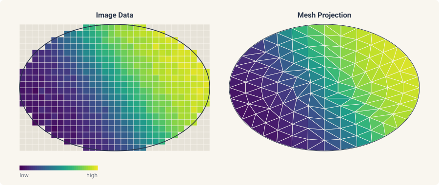
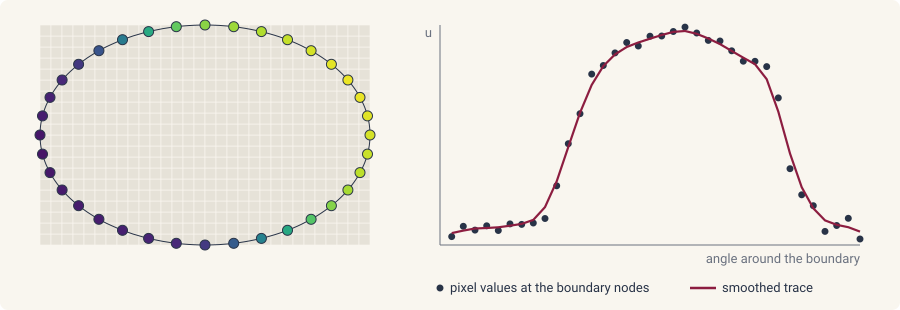

# Data assimilation

This page provides an overview of assimilating image data into a
modeling and inference workflow. The running example is a set of image
frames `frames` of a diffusing field on an oval, taken at the times
`ts`, with square pixels of side `pixel_size` and the pixels outside the
oval holding `NaN`.

## Projecting image data onto a mesh

diff-soup provides operators for moving data between image space and
a finite-element mesh. The binary mask of the domain, `True` on the
oval and `False` elsewhere, is meshed with `mask_to_mesh`, a frame is
projected onto the mesh nodes with `interpolate_image_to_nodes`, and
`PixelAveragingOperator` maps a nodal field back to the pixels.



```python
from diff_soup.domains.geometry import mask_to_mesh
from diff_soup.inference.data import PixelAveragingOperator, interpolate_image_to_nodes

mask = np.isfinite(frames[0])                                    # True on the oval
mesh = mask_to_mesh(mask, mesh_size=0.05, pixel_size=pixel_size)     # triangles inside the oval
pixel_origin = (pixel_size / 2, pixel_size / 2)                    # the center of pixel [0, 0]
u0 = interpolate_image_to_nodes(frames[0], mesh.points, pixel_origin=pixel_origin,
                                pixel_size=pixel_size, fill=0.0)   # the first frame at the nodes
op = PixelAveragingOperator.from_mesh_and_image(
    mesh.points, mesh.cells, image_shape=mask.shape, pixel_origin=pixel_origin,
    pixel_size=pixel_size, valid_mask=mask)
images = frames[:, mask]                                           # the observed pixels, one row per frame
```

- `mask_to_mesh(mask, mesh_size=1.0, pixel_size=1.0, origin=(0.0, 0.0))`
  triangulates the region where the mask is `True`. `mesh_size=` is
  the triangle size in physical units, `pixel_size=` the side of one
  pixel, and `origin=` the physical position of the image corner. It
  needs the optional dependency `gmsh`.
- `interpolate_image_to_nodes(image, points, pixel_origin=(0.0, 0.0),
  pixel_size=1.0, *, fill=None)` gives one value per mesh node by
  interpolating between the pixels around it. `pixel_origin=` is the
  center of pixel `[0, 0]`. A node outside the image takes the nearest
  pixel. `fill=` replaces every non-finite pixel before interpolation,
  so the pixels outside the oval take `fill=0.0` here; the default
  `None` propagates `NaN`.
- `PixelAveragingOperator.from_mesh_and_image(points, cells,
  image_shape=, pixel_origin=, pixel_size=, valid_mask=None,
  ele_type="TRI3")` builds the observation operator. `op.predict(u)`
  returns the pixels a nodal field predicts, in the order of
  `images`, and `op.to_image(pixels)` puts them back into an image.
- `UpConvDownOperator.from_mesh_and_image(..., upscale=10)` is the
  operator for a blurred image, with a one-pixel blur applied on a
  grid `upscale` times finer than the image. It needs matplotlib.

## Estimating the initial condition

`ds.inference.Experiment(..., initial_state=ds.inference.LearnedInitialState(guess), ...)`
fits the initial condition alongside the parameters, with `guess` the
starting value of the state at the start of the experiment's span. A
bare array stays a fixed state, and `ds.inference.FixedInitialState(y0)`
is the explicit form. The fitted state reads back from
`result.window_states[0]`, or `result.experiments[<id>].window_states[0]`,
a `(1, n_diff)` block under single shooting and the first window block
under a latent multishoot; both need `optsolve(..., diagnostics=True)`,
the default. Observed-state windows (`Windows.from_data`) refuse a
learned state.

## Interpolating boundary values

To directly impose Dirichlet boundary conditions from the image data,
we provide `extract_boundary_traces` and `smooth_boundary`:



```python
from diff_soup.inference.approx import PiecewiseLinear
from diff_soup.inference.data import extract_boundary_traces, smooth_boundary

boundary = mesh.boundary_nodes()
bc_raw = extract_boundary_traces(frames, mesh.points, boundary,
                                 pixel_origin=pixel_origin, pixel_size=pixel_size)
bc = smooth_boundary(bc_raw, mesh.points, boundary, c_lo=0.0, c_hi=1.0)
trace = PiecewiseLinear(ts, bc)                                    # one column per boundary node
```

- `extract_boundary_traces(frames, points, boundary_indices,
  pixel_origin=, pixel_size=, fill_nan=None)` returns one value per
  frame and boundary node. A `NaN` pixel takes `fill_nan`, or the
  frame's smallest finite value by default.
- `smooth_boundary(bc_raw, points, boundary_indices, method="spline",
  c_lo=, c_hi=)` smooths each frame around the contour and clips it to
  `[c_lo, c_hi]`. `method="spline"` fits a periodic smoothing spline
  with weights `1/sigma_eps` (`sigma_eps=0.01`), `method="savgol"`
  applies a periodic Savitzky-Golay filter with `window=7` and
  `order=3`, and `method="raw"` only clips.
- `PiecewiseLinear(ts, values)` turns the traces into a signal in time,
  passed as `spec.bc.dirichlet(node_indices=boundary, value_fn=trace)`
  ([function approximation](function-approximation.md)).

## Fitting from the frames

The recipe takes the mesh as its domain and the trace as its boundary
value. The operator's `predict` goes to `ds.inference.Measurement(observe=)`,
so the fit compares predicted pixels with the frames:

```python
spec = ds.problem("heat_oval")
spec.domain("sheet", mesh)
spec.field("u", mass="differential", scale=1.0)
D = spec.param("D", value=0.1, learnable=True, bounds=(0.01, 2.0))


@spec.equation(writes="u", reads=("u",))
def heat(q):
    return q.p.D * q.ops.laplacian(q.u)


spec.bc.dirichlet("u", node_indices=boundary, value_fn=trace)
problem = spec.build()
y0 = spec.assemble_state({"u": u0})

measurement = ds.inference.Measurement("image", ts, images, observe=op.predict,
                                       weight=1e6)
experiment = ds.inference.Experiment(problem, ds.JIDA(), (float(ts[0]), float(ts[-1])), y0, (measurement,))
result = ds.inference.optsolve(ds.inference.InferenceProblem(experiment, parameters=D))
result[D]                                                          # the fitted diffusivity
```
