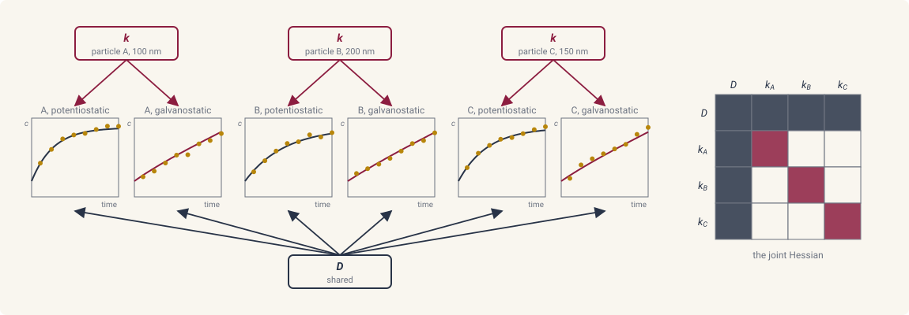

# Hierarchical fits

This page provides an overview of fitting several experiments together,
with parameters shared across all of them, tied within clusters of
experiments, or local to each experiment. Throughout, we fit synthetic
data from three electrode particles, each run under a potentiostatic and
a galvanostatic protocol. We recover a shared diffusivity and a
per-particle rate constant.

## The particle model

Each particle is a sphere of radius \(R\) in which the lithium filling
fraction \(c \in (0, 1)\) diffuses,

$$
\frac{\partial c}{\partial t} = D\,\nabla^2 c, \qquad r \in (0, R),
$$

with the intercalation flux into the particle at the surface given by
Butler-Volmer kinetics against the ideal-solution open-circuit
potential, in units of the thermal voltage,

$$
j(c_s, V) = k\,\sqrt{c_s (1 - c_s)}\,\big(e^{-\eta/2} - e^{\eta/2}\big),
\qquad \eta = V - \ln\frac{1 - c_s}{c_s},
$$

where \(c_s\) is the surface fraction, \(V\) the applied potential,
and \(k\) the rate constant. Under the potentiostatic protocol \(V\) is
held at a fixed value. Under the galvanostatic protocol the total
current \(4 \pi R^2 j\) is held at a fixed value and \(V\) is the
algebraic unknown that closes it
([constraints](../modeling/constraints.md#electrochemical-protocols)).
Simplifying the expression, the flux is
\(j = k\,[(1 - c_s)\,e^{-V/2} - c_s\,e^{V/2}]\), the form the recipe
evaluates. The recipe works in nanometers and seconds, and is a
template ([recipe templates](../modeling/parameters.md#recipe-templates))
whose arguments are the radius and the protocol, so that one
declaration serves every particle:

```python
n = 24


def intercalation_flux(c_s, V, k):
    return k * ((1.0 - c_s) * jnp.exp(-V / 2) - c_s * jnp.exp(V / 2))   # Butler-Volmer against the ideal OCV


@ds.recipe
def particle(R=100.0, protocol="potentiostatic"):
    spec = ds.problem(f"particle_{protocol}")
    spec.domain("particle", spherical_grid_1d(n, R, method="fvm"))
    spec.field("c", mass="differential", scale=1.0)
    spec.param("D", value=3e3, learnable=True, bounds=(1e2, 1e6))   # nm^2 / s, shared by every particle
    spec.param("k", value=10.0, learnable=True, bounds=(0.1, 1e3))  # nm / s, one value per particle

    @spec.equation(writes="c", reads=("c",))
    def diffusion(q):
        return q.p.D * q.ops.laplacian(q.c)

    if protocol == "potentiostatic":
        spec.control.potentiostatic(name="V", fn=lambda t: -2.0)
        spec.bc.flux("c", node_indices=np.array([n - 1]), fn=lambda q, t: intercalation_flux(q.c, q.control.V, q.p.k))
    else:
        spec.global_var("V", initial=-1.0)
        spec.bc.flux("c", node_indices=np.array([n - 1]), fn=lambda q, t: intercalation_flux(q.c, q.V, q.p.k))
        spec.constraint.galvanostatic(
            name="current", closes="V",
            current_fn=lambda q: 4 * jnp.pi * R**2 * intercalation_flux(q.c[n - 1], q.V, q.p.k),
            target_fn=lambda t: 4 * jnp.pi * R**2 * R / 12.0)
    return spec


D = particle.handle("D")
k = particle.handle("k")
```

Particle A has \(R = 100\) nm and \(k = 30\) nm/s, particle B has
\(R = 200\) nm and \(k = 15\) nm/s, particle C has \(R = 150\) nm and
\(k = 20\) nm/s, and all three share \(D = 10^4\) nm\(^2\)/s. The six
experiments are solved at those values
and sampled at ten times with noise of scale \(10^{-3}\).
Every particle starts at \(c = 0.2\):

```python
solver = ds.JIDA()
ts = jnp.linspace(0.2, 2.0, 10)
particles = {"A": 100.0, "B": 200.0, "C": 150.0}
k_true = {"A": 30.0, "B": 15.0, "C": 20.0}
experiments = []
for label, R in particles.items():
    for protocol in ("potentiostatic", "galvanostatic"):
        problem = particle.build(R=R, protocol=protocol)
        y0 = problem.assemble_state({"c": 0.2})
        theta_true = ds.default_theta(problem, {D: 1e4, k: k_true[label]})
        sol = ds.pdesolve(problem, solver, (0.0, 2.0), y0, theta=theta_true, saveat=ds.SaveAt(ts=ts))
        data = sol.ys + 1e-3 * np.random.default_rng(len(experiments)).standard_normal(sol.ys.shape)
        experiments.append(ds.inference.Experiment(
            particle, inputs={"R": R, "protocol": protocol}, id=f"{label}-{protocol}",
            solver=solver, t_span=(0.0, 2.0), initial_state=y0, parameters={"particle": label},
            measurements=(ds.inference.Measurement("c", ts, data, likelihood=ds.inference.Gaussian(sigma=1e-3)),)))
```

## The hierarchical least-squares problem

Here we parameterize the solution of experiment \(i\),
\(\hat u_i(\theta_s, \theta_{k(i)}, \theta_i)\), with three tiers of
learnable parameters: \(\theta_s\) shared across every experiment,
\(\theta_k\) tied within the cluster \(k(i)\) that experiment \(i\)
belongs to, and \(\theta_i\) local to experiment \(i\). The shared
tier holds the physics common to every experiment, such as a material's
diffusivity. A cluster holds what a group of experiments has in common,
such as the geometry of one particle run under several protocols. The
local tier holds what belongs to one experiment alone, such as a quantity
specific to its protocol. Given the observed data \(u_{\text{data}, i}\)
of each experiment, we fit every tier at once by minimizing the joint
least-squares loss

$$
\mathcal{L} = \tfrac{1}{2} \sum_{i=1}^{N}
\big\| \hat u_i(\theta_s, \theta_{k(i)}, \theta_i) - u_{\text{data}, i} \big\|_2^2 .
$$

In our example \(\theta_s = D\), the clusters are the three particles
with \(\theta_A = k_A\), \(\theta_B = k_B\), and \(\theta_C = k_C\), each
cluster holding
one potentiostatic and one galvanostatic experiment, and the local
tier is empty. The joint decision vector is ordered
\([\theta_s \mid \theta_A\, \theta_B \cdots \mid \theta_1 \cdots \theta_N]\).



Each experiment couples only to the shared block and to its own
cluster, so the Jacobian and the Hessian of the loss have an arrowhead
structure, one block per cluster bordered by the shared block. `ds.inference.TrustRegion` factors that structure cluster by cluster
and solves the shared block last, so the joint Hessian is never
assembled.

The full fit:

```python
hierarchy = ds.inference.Hierarchy(levels=("particle",), shared=(D,), per={"particle": (k,)})
study = ds.inference.Study(experiments, parameters=hierarchy)
lowered = ds.lower(study)
result = ds.inference.optsolve(lowered, ds.inference.TrustRegion())
result[D]            # the shared diffusivity
result[k]["A"]       # the rate constant of particle A
result[k]["B"]       # the rate constant of particle B
result[k]["C"]       # the rate constant of particle C
```

## Solving the hierarchical least-squares problem

To solve this problem, we declare one `ds.inference.Experiment` per
experiment, tie their parameters together in a `ds.inference.Study`
through a `ds.inference.Hierarchy`, lower the study with `ds.lower`, and
solve it using `ds.inference.optsolve` with
`ds.inference.TrustRegion()`.

### Declare the experiments

Each experiment is declared as on
[fitting parameters](fitting.md#declare-the-experiment), with the
template in place of a built problem and its arguments under `inputs=`.

```python
experiments.append(ds.inference.Experiment(
    particle, inputs={"R": R, "protocol": protocol}, id=f"{label}-{protocol}",
    solver=solver, t_span=(0.0, 2.0), initial_state=y0, parameters={"particle": label},
    measurements=(ds.inference.Measurement("c", ts, data, likelihood=ds.inference.Gaussian(sigma=1e-3)),)))
```

- `model` is the template. `inputs=` gives the arguments of this
  experiment's build, and the experiment builds the recipe for them.
- `inputs=` may also name a declared parameter, fixing its value for
  this experiment alone. A parameter that is fixed here and fitted
  through `parameters=` is refused.
- `id=` names the experiment in the result and in the reports. The
  default is built from `inputs=`.
- `parameters=` names the experiment's member of each level of the
  hierarchy, here the particle it belongs to.
- A built problem is accepted in place of the template, with the handles
  of any one build. A handle is matched to each experiment's declaration
  by name, and a declaration whose size or `learnable=` flag differs
  between experiments is refused.

### Pose the joint inference problem

`ds.inference.Hierarchy` declares which parameters are shared and which
take one value per member of a level, `ds.inference.Study` ties the
experiments to it, and `ds.lower` prepares the study for fitting ([pose
the inference problem](fitting.md#pose-the-inference-problem)).

```python
hierarchy = ds.inference.Hierarchy(levels=("particle",), shared=(D,), per={"particle": (k,)})
study = ds.inference.Study(experiments, parameters=hierarchy)
lowered = ds.lower(study)
```

- `levels=` names the levels between the study and its experiments,
  outermost first. Here the one level is the particle.
- `shared=` lists the handles with one value for the whole study.
- `per=` maps a level name to the handles that take one value per member
  of that level. The key `"experiment"` places a handle with one value
  per experiment.
- The experiments that name the same member share its value. The joint
  coordinates are named by member, `k@A` and `k@B`, in the reports.
- Bounds are those declared on the handle in each experiment, and a
  tied handle declares the same bounds in every experiment
  ([box bounds](fitting.md#box-bounds)).
- `layout=` on `ds.lower` places the experiments across several devices
  ([multi-GPU parallelism](multi-gpu.md)).
- `lowered.n_params` is the length of the joint decision vector.

### Run the fit

`ds.inference.TrustRegion()` is the recommended optimizer for a
hierarchical study. It is a trust-region Gauss-Newton method solved
level by level. The curvature is assembled one cluster at a time from
that cluster's experiments, and each step is solved from the clusters up
to the shared parameters.

```python
result = ds.inference.optsolve(lowered, ds.inference.TrustRegion())
```

The options, with their defaults:

- `hessian="gauss-newton"` uses the Gauss-Newton curvature, and `"true"`
  the exact Hessian.
- `max_steps=30` bounds the number of steps.
  `target_accepted_steps=None`, when set, ends the run after that many
  accepted steps with the status `ACCEPTED_STEPS`.
- `nested_at=None` names a level at which the fit splits into two loops.
  The levels above it take the outer step, and each member of that level
  then refits its own parameters.
- `radius_init=`, `radius_max=`, `eta=`, `grad_tol=`, `step_tol=`,
  `cost_tol=`, and `x_scale=` are the trust-region options of
  `ds.inference.NewtonTrustRegion` ([Newton trust
  region](solvers.md#newton-trust-region)).
- `weights=None` gives one nonnegative weight per cluster, multiplying
  that cluster's contribution to the loss.
- `constraints=()` and `gauges=()` add linear equality constraints on
  the joint vector, `LinearConstraint` and `Gauge` from
  `diff_soup.inference.statistics.parameters`. A gauge pins a direction
  the data leave free, such as the mean of a spatial field.
- `fixed_indices=()` freezes the joint coordinates at those indices.
- `callbacks=()` attaches callbacks to the solver
  ([run the fit](fitting.md#run-the-fit)).
- `ds.inference.optsolve(lowered, ..., checkpoint=directory)` saves the
  fit after every attempt and, when the directory already holds one,
  resumes from the newest.

`ds.inference.NewtonTrustRegion()` and
`ds.inference.LevenbergMarquardt()` also fit a lowered study, by dense
steps over the whole joint vector. `TrustRegion` is the best choice when
the joint vector is large, since its curvature stays cluster-local.

### Analyze the result

The result object carries the fields of a single fit
([analyze the result](fitting.md#analyze-the-result)) with the joint
structure on top.

```python
result[D]                                     # the shared diffusivity
result[k]                                     # {"A": ..., "B": ..., "C": ...}, one value per cluster
result.experiments["A-potentiostatic"][k]     # the value that experiment used
result.experiments["A-potentiostatic"].opt_params
```

- `result[D]` returns the fitted value of a shared handle, and
  `result[k]` a dictionary from cluster label to the fitted value of a
  varying handle.
- `result.experiments` holds one entry per experiment by its `id`, with
  `[handle]` the value that experiment used, and `opt_params` the
  experiment's parameters in the form `ds.pdesolve` takes through
  `theta=`.
- `result.params` is the joint decision vector, shared handles first.

## Uncertainty across the population

The uncertainty methods of
[statistical estimation](statistical-estimation.md#standard-errors-and-covariance)
and [identifiability](identifiability.md) take the joint problem and its
fit, and index their results by handle and by cluster label. The
population methods estimate the spread of a parameter across the
clusters:

```python
posterior = ds.inference.laplace(lowered, result)
posterior[D].sd                                      # the standard error of the shared diffusivity
posterior[k]["A"].sd                                 # the standard error of the rate constant of particle A
posterior.cov[D, k][None, "A"]                       # the covariance of D with k of particle A

robust = ds.inference.cluster_covariance(lowered, result, cluster="particle")
boot = ds.inference.bootstrap(lowered, result, replicates=100, key=jax.random.key(0))
boot.interval(D)                                     # the bootstrap interval of the shared diffusivity
prof = ds.inference.profile(lowered, result, k, owner="A", optimizer=ds.inference.TrustRegion(), max_steps=8)
prof.interval(0.95)                                  # the profile interval of the rate constant of particle A
```

- `ds.inference.laplace(problem, fit)` is the Laplace approximation of
  the joint posterior. `posterior[D]` is the marginal of a shared handle,
  `posterior[k]["A"]` the marginal of a varying handle in one cluster,
  and `posterior.cov[D, k]` a dictionary of covariances keyed by the
  pair of cluster labels, `None` for a shared handle.
- `ds.inference.cluster_covariance(problem, fit, *, cluster)` estimates
  the covariance of the fit from the spread of the residuals between the
  clusters of `cluster`, without trusting the declared noise scale.
- `ds.inference.bootstrap(problem, fit, *, replicates, key)` refits the
  study `replicates` times with the clusters reweighted, and
  `boot[handle]` returns the fitted values across the replicates. It
  refuses fewer than three clusters, naming the count and the minimum.
  `steps=3` is the number of accepted trust-region steps each replicate
  takes from the fit, and `steps="refit"` refits each replicate to
  convergence. `checkpoint=` saves the run to a directory, and a later
  call with the same arguments resumes from it.
- `ds.inference.profile(problem, fit, handle, *, owner=, optimizer=)`
  walks one cluster's value of a varying handle, named by `owner=`, with
  every other parameter refitted by `ds.inference.TrustRegion`
  ([the profile likelihood](identifiability.md#the-profile-likelihood)).
