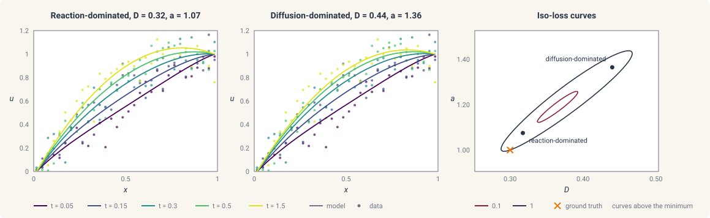

# Identifiability

This page provides an overview of determining practical identifiability
of fitted parameters given the dataset. Throughout, we fit synthetic
data generated by solving the heat equation of
[statistical estimation](statistical-estimation.md) with a source term,

$$
\frac{\partial u}{\partial t} = D\,\frac{\partial^2 u}{\partial x^2} + a, \qquad x \in (0, 1),
$$

with \(u(0, t) = u_0 = 0\), \(u(1, t) = u_1 = 1\), \(u(x, 0) = x\),
\(D = 0.3\), and \(a = 1\), observed at five times between \(t = 0.05\)
and \(t = 1.5\) with noise of scale \(10^{-1}\). Over that window the
solution approaches the steady state

$$
u = -\frac{a}{2D}\,x^2 + \Big(u_1 - u_0 + \frac{a}{2D}\Big)\,x + u_0,
$$

which depends on the diffusivity and the source amplitude only through
\(a / D\), so that the two can trade off against each other:

```python
import jax

jax.config.update("jax_enable_x64", True)

import jax.numpy as jnp
import numpy as np

import diff_soup as ds
from diff_soup.domains import cartesian_grid_1d

n = 32
spec = ds.problem("heat_source")
spec.domain("rod", cartesian_grid_1d(n, 0.0, 1.0, method="fvm"))
spec.field("u", mass="differential", scale=1.0, init=lambda x: x)
spec.param("D", value=0.3)                                            # the generating diffusivity
spec.param("a", value=1.0)                                            # the generating source amplitude


@spec.equation(writes="u", reads=("u",))
def heat(q):
    return q.p.D * q.ops.laplacian(q.u) + q.p.a


spec.bc.dirichlet("u", node_indices=np.array([0]), value=0.0)
spec.bc.dirichlet("u", node_indices=np.array([n - 1]), value=1.0)
problem_true = spec.build()
y0 = spec.assemble_state({})
solver = ds.JIDA()

ts = jnp.array([0.05, 0.15, 0.3, 0.5, 1.5])
sol_true = ds.pdesolve(problem_true, solver, (0.0, 1.5), y0, saveat=ds.SaveAt(ts=ts))
data = sol_true.ys + 1e-1 * np.random.default_rng(0).standard_normal(sol_true.ys.shape)
```

## The practical identifiability problem

A parameter is structurally identifiable when it can be uniquely
determined from noiseless data. Structural identifiability is out of
scope for diff-soup.

A parameter is practically identifiable when it can be determined up to
a given precision from noisy data.

Here we fit the two parameters \(\theta = (D, a)\) through maximum
likelihood estimation
([statistical estimation](statistical-estimation.md)). Physically, we
observe the rod gradually heat to the quadratic profile, but the noisy
data can be explained both through a reaction-dominated mechanism (left
panel) and through a diffusion-dominated mechanism (middle panel).



As shown in the iso-loss curves, the high noise level induces a
degeneracy in the loss surface that shows up as an elongated diagonal
stretch. This model problem demonstrates the practical identifiability
problem, since many plausible parameter combinations explain the data.

To address this problem, we can analyze the Fisher information matrix

$$
\mathrm{FIM} = S^\top \Sigma^{-1} S ,
$$

where \(S\) is the sensitivity of the predicted data to the parameters
and \(\Sigma\) the covariance of the measurement noise.

The eigendecomposition and null space provide valuable information about
the inference problem. The eigenvalues describe the curvature of the
iso-loss surface, and the condition number, the ratio of the largest to
the smallest eigenvalue, gives a quantitative metric for how identifiable
the parameters are. The eigenvectors describe the correlation structure
of the parameters. The null space describes the exact degeneracy of
parameters.

In diff-soup we calculate the Fisher information matrix and compute its
condition number with `ds.inference.identifiability`, and we get a
comprehensive diagnostic profile with `ds.inference.profile`, which fixes
the \(j\)-th parameter at each value of a grid, refits the likelihood
over the other parameters, and reads the confidence interval off the
values where the profiled negative log likelihood stays within
\(\tfrac{1}{2}\chi^2_{1,\alpha}\) of its minimum. The full analysis:

```python
spec = ds.problem("heat_source")
spec.domain("rod", cartesian_grid_1d(n, 0.0, 1.0, method="fvm"))
spec.field("u", mass="differential", scale=1.0, init=lambda x: x)
D = spec.param("D", value=0.1, learnable=True, bounds=(0.01, 2.0))      # the learnable diffusivity
a = spec.param("a", value=0.5, learnable=True, bounds=(0.0, 5.0))       # the learnable source amplitude


@spec.equation(writes="u", reads=("u",))
def heat(q):
    return q.p.D * q.ops.laplacian(q.u) + q.p.a


spec.bc.dirichlet("u", node_indices=np.array([0]), value=0.0)
spec.bc.dirichlet("u", node_indices=np.array([n - 1]), value=1.0)
problem = spec.build()
y0 = spec.assemble_state({})

measurement = ds.inference.Measurement("u", times=ts, values=data,
                                       likelihood=ds.inference.Gaussian(sigma=1e-1))
experiment = ds.inference.Experiment(model=problem, solver=solver, t_span=(0.0, 1.5),
                                     initial_state=y0, measurements=(measurement,))
est = ds.inference.InferenceProblem(experiment, parameters=(D, a))
fit = ds.inference.optsolve(est, ds.inference.LevenbergMarquardt())                     # the maximum-likelihood fit

ident = ds.inference.identifiability(est, fit)                                          # the information spectrum at the fit
ident.raw.condition_number                                                              # the ratio of the largest to the smallest eigenvalue
prof = ds.inference.profile(est, fit, D, levels=(0.95,))                                # the profile likelihood of D
prof.interval(0.95)                                                                     # the 95% confidence interval of D
```

## Analyzing identifiability

The fit is the maximum-likelihood fit of
[statistical estimation](statistical-estimation.md#solving-the-estimation-problem)
with two handles. The analysis then takes the inference problem and its
fit.

### The information spectrum

`ds.inference.identifiability(problem, fit, *, parameter_scales=None,
ridge=1e-10, null_tol=1e-10)` computes the information matrix at the fit
and reports its spectrum. For a MAP fit the prior is left out, so that a
prior cannot hide a direction the data leaves open.

```python
ident = ds.inference.identifiability(est, fit)
ident.names                              # ("D", "a")
ident.raw.condition_number               # the ratio of the largest to the smallest eigenvalue
ident.raw.sensitivity_rank               # the number of directions the data determine
ident.raw.null_directions                # the directions the data do not see, empty here
ident.scaled.eigenvalues                 # the spectrum after scaling each parameter
```

- `fit` is the fit result, or a mapping from handle to value,
  `{D: 0.3, a: 1.0}`, to analyze another point.
- `parameter_scales=` gives one scale per parameter, `{D: 0.1, a: 1.0}`,
  so that parameters of different units compare. The default scales every
  parameter by one. `ident.raw` is the spectrum in the parameters' own
  units, and `ident.scaled` the spectrum after the scaling.
- `null_tol=` is the fraction of the largest eigenvalue below which a
  direction counts as unseen and is listed in `null_directions`, each
  with its `eigenvalue`, its `loadings` on the parameters, and a
  `description` in words.
- `ridge=` regularizes the correlation matrix of the report only.
- Each of `ident.raw` and `ident.scaled` carries `eigenvalues`,
  `loadings`, `correlation`, `condition_number`, `sensitivity_rank`,
  `null_directions`, and `notes`.

### The profile likelihood

`ds.inference.profile(problem, fit, handle, *, owner=None,
optimizer=None, levels=(0.95,), bounds=None, max_steps=24,
multistart=0, multistart_scale=1.0)` walks one parameter away from the
fit in both directions, refitting every other parameter at each step,
until the negative log likelihood has risen past the threshold of every
level:

```python
prof = ds.inference.profile(est, fit, D, levels=(0.95,), max_steps=24)
prof.interval(0.95)      # the lower and upper bounds of the 95% interval
prof.threshold(0.95)     # half the chi-squared quantile with one degree of freedom
prof.grid                # the values of D the walk visited
prof.delta_nll           # the rise of the negative log likelihood at each of them
prof.open_directions     # the sides that never reached the threshold, empty here
```

- `handle` is the parameter to profile, a scalar handle returned by
  `spec.param`. A parameter with one value per cluster takes `owner=`
  ([hierarchical fits](hierarchical.md)). A function handle is refused.
- `levels=` lists the confidence levels the walk covers, and
  `prof.interval(level)` returns the lower and upper bounds at one of
  them. An open side is reported as `inf`.
- `max_steps=` caps the number of steps per side.
- `bounds=(lo, hi)` narrows the range of the walk. The bounds declared on
  the handle apply as well, and a side the walk cannot cross within them
  is open.
- `multistart=` refits each step from that many perturbed starts, with
  `multistart_scale=` the size of the perturbation. The default refits
  from the previous step.
- `optimizer=` is the refitting algorithm. The default is
  `ds.inference.LevenbergMarquardt()`. A hierarchical study also
  accepts `ds.inference.TrustRegion()`
  ([hierarchical fits](hierarchical.md)). Any other algorithm is refused.
- A fit that did not converge is refused. A MAP fit profiles the
  posterior objective instead, and its intervals carry no coverage
  guarantee.
- A multiple-shooting fit that fits its window starts is refused. Refit
  with single shooting from its parameters and profile that fit.

## Sensitivity runs

The information matrix is built from the sensitivity \(S\) of the
solution to the parameters. `ds.inference.sensitivity_solve(problem,
t_span, y0, *, wrt, saveat, solver=None)` computes it directly for a
built problem, before any data exists, which is how an experiment is
judged before it is run:

```python
run = ds.inference.sensitivity_solve(problem, (0.0, 1.5), y0, wrt=(D, a),
                                     saveat=ds.SaveAt(ts=ts), solver=solver)
S = run.sensitivities()      # the sensitivity of every saved value to D and to a
run.x0                       # the parameter values the sensitivities are taken at
```

- `wrt=` is the tuple of handles the sensitivities are taken with respect
  to.
- `saveat=` gives the times the sensitivities are saved at, and
  `solver=` the time-stepping solver
  ([ODE/DAE solvers](../simulation/solvers.md)).
- `run.sensitivities(x=None)` returns the sensitivities at the parameter
  values `x`, the declared values by default, and `run(x)` returns the
  saved solution values there. The run solves in the forward sensitivity
  mode of [sensitivities and autodiff](../simulation/sensitivities.md).

## The practical identifiability report

`ds.inference.practical_report(problem, fit, *, posterior=None,
profiles=(), tolerances=None, report=None, experiment_id=None)` collects
the evidence of this page in one object. It carries the information
spectrum at the fit, a summary of each supplied profile, the standard
errors of a supplied Laplace approximation, and the residual report of
[goodness of fit](statistical-estimation.md#goodness-of-fit). It states
no overall verdict:

```python
posterior = ds.inference.laplace(est, fit)
practical = ds.inference.practical_report(
    est, fit, posterior=posterior, profiles=(prof,), tolerances={"D": 0.01, "a": 0.1})
practical.local_sensitivity.raw.condition_number   # the spectrum at the fit
practical.likelihood_geometry                   # one summary per supplied profile
practical.status                                # one pass or fail per named tolerance
practical.provenance["missing_evidence"]        # the sections not supplied, none here
```

- `posterior=` is the Laplace approximation of
  [standard errors and covariance](statistical-estimation.md#standard-errors-and-covariance).
- `profiles=` is a tuple of profile results.
- `tolerances=` maps a parameter name to the largest standard error it
  may have, and each `status` entry compares the standard error of the
  supplied posterior against that number. A tolerance without a
  posterior is refused.
- `report=` reuses an identifiability report already computed at this
  fit, and `experiment_id=` selects the experiment of the residual report
  when several are fitted together.

## Function-valued parameters

A learnable function of
[function approximation](function-approximation.md) is fitted through
its coefficients, and its identifiability is a question about the
function rather than about any one coefficient.
`ds.inference.function_report(information, block, *, gram=None)` takes
the coefficients of one function out of an information matrix,
eliminates the other parameters, and reports the eigenvalues against the
function's own norm. For the Legendre diffusivity of
[function approximation](function-approximation.md#orthogonal-polynomials-in-one-dimension)
fitted as an inference problem `est_f` with the fit `fit_f`:

```python
from diff_soup.inference.approx import Legendre

info_f = ds.inference.information(est_f, at=fit_f)
gram = Legendre(jnp.asarray(fit_f.params), interval=(0.0, 1.0)).gram()
report_f = ds.inference.function_report(info_f, "D_of_x", gram=gram)
report_f.eigenvalues      # the information per unit of the function's squared norm, one per mode
report_f.names
```

- `block` names the function handle.
- `gram=` is the Gram matrix of the function's basis, from the basis
  object's `gram()`.
