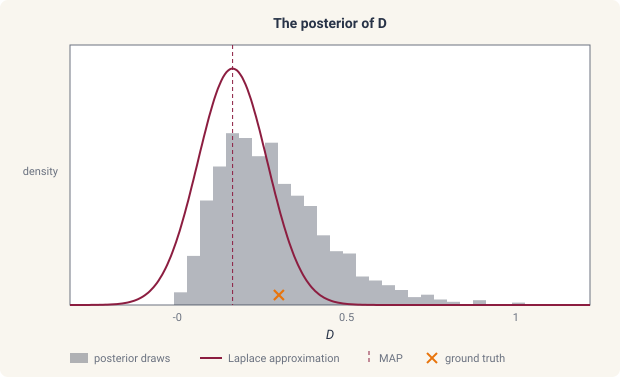

# Posterior sampling

This page provides an overview of sampling the posterior of a
statistical fit with `ds.inference.sample`. Throughout, we sample the posterior of an adsorption-diffusion model,
a rod that loses solute to a saturating sink,

$$
\frac{\partial u}{\partial t} = D\,\frac{\partial^2 u}{\partial x^2} - a\,\frac{u}{1 + u}, \qquad x \in (0, 1),
$$

with \(u(0, t) = 0\), \(u(1, t) = 1\), \(u(x, 0) = x\), \(D = 0.3\), and
\(a = 1\), observed at five times between \(t = 0.05\) and \(t = 1.5\)
with noise of scale \(10^{-1}\), and with a normal prior on each of the
two parameters:

```python
import jax

jax.config.update("jax_enable_x64", True)

import jax.numpy as jnp
import numpy as np

import diff_soup as ds
from diff_soup.domains import cartesian_grid_1d

n = 32
spec = ds.problem("adsorption")
spec.domain("rod", cartesian_grid_1d(n, 0.0, 1.0, method="fvm"))
spec.field("u", mass="differential", scale=1.0, init=lambda x: x)
spec.param("D", value=0.3)                                            # the generating diffusivity
spec.param("a", value=1.0)                                            # the generating adsorption rate


@spec.equation(writes="u", reads=("u",))
def adsorption(q):
    return q.p.D * q.ops.laplacian(q.u) - q.p.a * q.u / (1.0 + q.u)


spec.bc.dirichlet("u", node_indices=np.array([0]), value=0.0)
spec.bc.dirichlet("u", node_indices=np.array([n - 1]), value=1.0)
problem_true = spec.build()
y0 = spec.assemble_state({})
solver = ds.JIDA()

ts = jnp.array([0.05, 0.15, 0.3, 0.5, 1.5])
sol_true = ds.pdesolve(problem_true, solver, (0.0, 1.5), y0, saveat=ds.SaveAt(ts=ts))
data = sol_true.ys + 1e-1 * np.random.default_rng(0).standard_normal(sol_true.ys.shape)
```

## The posterior

During maximum a posteriori estimation
([statistical estimation](statistical-estimation.md#the-estimation-problem)),
we seek to maximize the posterior

$$
p(\theta \mid u_{\text{data}}) \propto p(u_{\text{data}} \mid \theta)\, p(\theta)
$$

and obtain an optimal value \(\theta_{\text{MAP}}\). In order to quantify
the uncertainty in our estimate \(\theta_{\text{MAP}}\), we need to
estimate the full posterior distribution. The Laplace approximation
([standard errors and covariance](statistical-estimation.md#standard-errors-and-covariance))
estimates it by a Gaussian centered on \(\theta_{\text{MAP}}\), with the
curvature of the negative log posterior there as its inverse covariance.
For nonlinear problems this can fail, as shown below for the diffusivity
of the adsorption-diffusion model:



Instead, we can sample from the full posterior using Markov chain Monte
Carlo methods provided by
[blackjax](https://github.com/blackjax-devs/blackjax). We can draw
samples from the full distribution in order to carry out a variety of
uncertainty quantification tasks: assign credible intervals to each
parameter, compute posterior means and correlations, propagate the
parameter uncertainty to a band around the predicted solution, and carry
it through the coefficients of a parameterized function
([function approximation](function-approximation.md)) to a band around
the function itself. In this page we describe the process of posterior
sampling in diff-soup and the typical workflows for PDE inference
problems. The full sampling run:

```python
spec = ds.problem("adsorption")
spec.domain("rod", cartesian_grid_1d(n, 0.0, 1.0, method="fvm"))
spec.field("u", mass="differential", scale=1.0, init=lambda x: x)
D = spec.param("D", value=0.1, learnable=True, bounds=(0.01, 2.0),
               prior=ds.inference.NormalPrior(mean=0.3, scale=0.3))        # the learnable diffusivity and its prior
a = spec.param("a", value=0.5, learnable=True, bounds=(0.0, 5.0),
               prior=ds.inference.NormalPrior(mean=1.0, scale=1.0))        # the learnable adsorption rate and its prior


@spec.equation(writes="u", reads=("u",))
def adsorption(q):
    return q.p.D * q.ops.laplacian(q.u) - q.p.a * q.u / (1.0 + q.u)


spec.bc.dirichlet("u", node_indices=np.array([0]), value=0.0)
spec.bc.dirichlet("u", node_indices=np.array([n - 1]), value=1.0)
problem = spec.build()
y0 = spec.assemble_state({})

measurement = ds.inference.Measurement("u", times=ts, values=data,
                                       likelihood=ds.inference.Gaussian(sigma=1e-1))
experiment = ds.inference.Experiment(model=problem, solver=solver, t_span=(0.0, 1.5),
                                     initial_state=y0, measurements=(measurement,))
est = ds.inference.InferenceProblem(experiment, parameters=(D, a), objective=ds.inference.MAP())   # the MAP problem
fit = ds.inference.optsolve(est, ds.inference.LevenbergMarquardt())                            # its mode

draws = ds.inference.sample(est, fit, key=jax.random.PRNGKey(0), chains=2, draws=1000, warmup=300)   # draw from the posterior
report = ds.inference.mcmc_report(draws)                                                 # check the draws
draws[D]                                                                                 # the draws of D
```

## Sampling the posterior

To sample the posterior, we run a sampler on the MAP problem and its
fit with `ds.inference.sample`, and check the draws with
`ds.inference.mcmc_report`.

### Run the sampler

`ds.inference.sample(problem, fit, *, kernel="nuts", chains=4,
draws=1000, warmup=500, key, preconditioner="laplace",
curvature="observed", nuts_target_acceptance=0.8, chain_map=None)` runs one chain
per `chains` on the posterior of the MAP problem and returns the draws.
An MLE problem is refused, since it has no prior.

```python
draws = ds.inference.sample(est, fit, key=jax.random.PRNGKey(0), chains=2, draws=1000, warmup=300)
```

- `fit` is the MAP fit the chains start from.
- `key` is the random key. The same key reproduces the same draws.
- `kernel="nuts"` is the No-U-Turn sampler and the default. It follows
  the gradient of the posterior and adapts its step size and scale
  during the warmup. `kernel="rmh"` is the random-walk Metropolis
  kernel, which proposes Gaussian steps of a fixed size and needs no
  gradient. Any other name is refused.
- `chains=` is the number of chains, each started from a perturbed
  copy of the fit.
- `draws=` is the number of draws kept per chain, and `warmup=` the
  number discarded first, during which NUTS adapts.
- `preconditioner="laplace"` scales the proposals of either kernel by
  the Laplace approximation of
  [standard errors and covariance](statistical-estimation.md#standard-errors-and-covariance),
  so that the chains move at the width of the posterior from the first
  step. `None` runs the chains without it.
- `curvature="observed"` is the default curvature of that Laplace
  approximation. `"expected"` uses the expected curvature instead.
- `nuts_target_acceptance=0.8` is the acceptance rate NUTS adapts its
  step size toward during the warmup.
- `chain_map=` places the chains. The default runs them as one batched
  call. `"sequential"` runs them one after another. `"devices"` places
  whole chains on the local devices, with `chains` a multiple of the
  device count. `draws.chain_map` records the placement that ran.
- A parameter with bounds is sampled in an unbounded coordinate, and
  every draw is returned in the parameter's own coordinate.

### Analyze the draws

The draws are returned in the parameters' own coordinate, one array
over the chains, the draws, and the parameters, and `draws[D]` returns
the draws of one parameter.

```python
draws.values.shape       # (2, 1000, 2), the chains, the draws, and the parameters
draws[D]                 # the draws of D, over the chains and the draws
draws.names              # the parameter labels
draws.info               # the acceptance rate and, for NUTS, the divergences per draw
predictive = ds.inference.predict(est, draws, kind="predictive")["u"]   # the solution over the draws, with noise
```

- `draws.values` holds the draws and `draws.names` labels them.
  `draws[D]` returns the draws of one parameter, and a dictionary by
  cluster for a parameter that varies by cluster
  ([hierarchical fits](hierarchical.md)).
- `draws.info` holds one value per draw of `acceptance_rate`, and for
  NUTS `is_divergent` and `num_integration_steps`.
- `ds.inference.predict(problem, draws, kind=)` solves the model at
  every draw and summarizes the predicted values, the sampled
  counterpart of the
  [prediction bands](statistical-estimation.md#prediction-bands).

Whether the draws represent the posterior is the question of
[diagnostics](#diagnostics), checked before any summary is taken.

## Diagnostics

A chain represents the posterior only once it has forgotten its
starting point and visited the posterior in proportion to its
density, and a finite number of correlated draws carries less
information than the same number of independent ones.
`ds.inference.mcmc_report(draws, *, rhat_max=1.01, ess_floor=400.0)`
checks both and flags the failures in words. Each chain needs at
least eight draws.

```python
report = ds.inference.mcmc_report(draws)
report.rhat              # near one when the chains agree
report.ess_bulk          # the number of independent draws the chains are worth
report.flags             # the failed checks in words, empty here
report.ok                # whether every check passed, True here
print(report.summary())  # the table of the above
```

- `rhat` compares the spread within each chain to the spread between
  them, per parameter, and is near one when the chains agree. It is
  flagged above `rhat_max`.
- `ess_bulk` and `ess_tail` are the effective sample sizes for the
  center and for the tails of the posterior, the number of independent
  draws the chains are worth. Each is flagged below `ess_floor`.
- `mean`, `sd`, and `mcse_mean` are the posterior mean, the posterior
  standard deviation, and the Monte Carlo error of the mean, per
  parameter.
- `acceptance_rate` and `acceptance_rate_per_chain` summarize the
  proposals, and for NUTS `n_divergent`, `divergences_per_chain`,
  `tree_depth_max`, and `tree_depth_mean` summarize the integration.
- `flags` lists the failed checks, `ok` is `True` when it is empty,
  and `summary()` renders a table of the above as text.

The diagnostics are the rank-normalized split \(\hat R\) and effective
sample sizes of Vehtari et al. (2021) ([references](#references)).

## Preconditioning

The random-walk kernel steps with a fixed size, so it moves well only
in a coordinate where the posterior has unit scale, and NUTS adapts
faster from one. The default `preconditioner="laplace"` builds that
coordinate from the Laplace approximation of
[standard errors and covariance](statistical-estimation.md#standard-errors-and-covariance),
the affine map \(w \mapsto c + A w\) with \(c\) the mode and
\(AA^\top\) the covariance, and runs the chains in \(w\). A Laplace
approximation with an undetermined direction, from
`ds.inference.laplace(on_singular="subspace")`, cannot precondition
the chains ([identifiability](identifiability.md)). For example, the
random-walk kernel with and without it:

```python
draws_rmh = ds.inference.sample(est, fit, key=jax.random.PRNGKey(0), kernel="rmh",
                                chains=2, draws=300, warmup=100)
draws_raw = ds.inference.sample(est, fit, key=jax.random.PRNGKey(0), kernel="rmh",
                                chains=2, draws=300, warmup=100, preconditioner=None)
ds.inference.mcmc_report(draws_rmh).acceptance_rate      # the fraction of proposals accepted
ds.inference.mcmc_report(draws_raw).acceptance_rate
```

## Credible bands for fitted functions

A learnable function of
[function approximation](function-approximation.md) is fitted through
its coefficients, so its draws are coefficient vectors, and a credible
band for the function follows by evaluating it at every draw. For
example, with the diffusivity of the adsorption model allowed to vary
along the rod as a Legendre expansion:

```python
from diff_soup.inference.approx import Legendre

spec_f = ds.problem("adsorption_function")
spec_f.domain("rod", cartesian_grid_1d(n, 0.0, 1.0, method="fvm"))
spec_f.field("u", mass="differential", scale=1.0, init=lambda x: x)
D_of_x = spec_f.function("D_of_x", Legendre(jnp.array([np.log(0.3), 0.0, 0.0]), interval=(0.0, 1.0),
                                             transform=lambda x, p: jnp.exp(p)),
                         learnable=True, prior=ds.inference.GaussianCoefficientPrior(scale=1.0))   # a diffusivity along the rod and its prior
a_f = spec_f.param("a", value=0.5, learnable=True, bounds=(0.0, 5.0),
                   prior=ds.inference.NormalPrior(mean=1.0, scale=1.0))


@spec_f.equation(writes="u", reads=("u",))
def adsorption_f(q):
    return q.ops.div_flux(q.fn.D_of_x(q.x[:, 0]), q.u) - q.p.a * q.u / (1.0 + q.u)


spec_f.bc.dirichlet("u", node_indices=np.array([0]), value=0.0)
spec_f.bc.dirichlet("u", node_indices=np.array([n - 1]), value=1.0)
problem_f = spec_f.build()
est_f = ds.inference.InferenceProblem(
    ds.inference.Experiment(problem_f, solver, (0.0, 1.5), spec_f.assemble_state({}), (measurement,)),
    parameters=(D_of_x, a_f), objective=ds.inference.MAP())
fit_f = ds.inference.optsolve(est_f, ds.inference.LevenbergMarquardt())
draws_f = ds.inference.sample(est_f, fit_f, key=jax.random.PRNGKey(0), chains=2, draws=500, warmup=300)

coeffs = draws_f[D_of_x].reshape(-1, 3)                                              # one coefficient vector per draw
xs = jnp.linspace(0.0, 1.0, 101)
curves = jax.vmap(lambda c: Legendre(c, interval=(0.0, 1.0), transform=lambda x, p: jnp.exp(p))(xs))(coeffs)   # D(x) at every draw
lower, upper = jnp.percentile(curves, jnp.array([2.5, 97.5]), axis=0)                # the pointwise 95% credible band
```

- `draws[handle]` on a function handle returns the draws of its
  coefficients, one row per draw after the reshape, in the order of the
  expansion.
- The band is pointwise, one interval per position, and the same
  percentiles over `curves` give the band of any transform of the
  function.

## References

- A. Vehtari, A. Gelman, D. Simpson, B. Carpenter, and P.-C. Bürkner.
  Rank-normalization, folding, and localization: an improved
  \(\hat R\) for assessing convergence of MCMC (with discussion).
  Bayesian Analysis, 16(2):667–718, 2021.
  [doi:10.1214/20-BA1221](https://doi.org/10.1214/20-BA1221).
