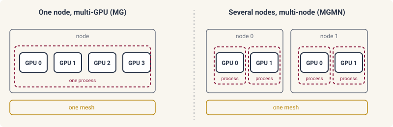

# Multi-GPU parallelism

This page provides an overview of running an inference problem on
several GPUs. diff-soup supplies two kinds of parallelism. Data
parallelism splits the experiments of a fit across the devices, and each
device solves its share. Model parallelism splits one simulation across
the devices, so a sparse factorization too large for one GPU is factored
by several. Both are declared through the axes of a device mesh on
`ds.Layout` ([linear solvers](../simulation/linear.md#device-placement)).
Throughout, we reuse the three-particle model and its six experiments from
[hierarchical fits](hierarchical.md#the-particle-model).

## Data parallelism

It is common that many datasets can be naturally partitioned into
batches, for example, independent experiments in
[hierarchical fits](hierarchical.md) or windows in
[multiple shooting](multiple-shooting.md). Under the data parallelism
paradigm, these batches are distributed across devices, where each
device solves its own batch and the optimizer sums the cost, the
gradient, and the curvature across the devices at every step, so the
fit is the same as on one device.

```python
mesh = ds.global_mesh(("data",))
layout = ds.Layout(mesh=mesh)

lowered = ds.lower(study, layout=layout)
result = ds.inference.optsolve(lowered, ds.inference.TrustRegion())
```

- `ds.global_mesh(("data",))` builds a device mesh over every GPU
  JAX sees, and the experiments are split along its `data` axis.
- `layout=` on `ds.lower` places the experiments on the mesh ([pose the
  joint inference
  problem](hierarchical.md#pose-the-joint-inference-problem)). The
  default `None` runs on one device.
- `ds.inference.TrustRegion` drives a study split across devices ([run
  the fit](hierarchical.md#run-the-fit)).
- `balance_steps=` on the layout moves experiments between devices when
  one device holds several and their step counts differ. The default
  enables it whenever a device holds more than one experiment, and
  `False` keeps the initial assignment.

Use data parallelism when every batch fits on one GPU and there are at
least as many batches as devices. It costs no communication inside a
solve.

## Model parallelism

One simulation whose sparse factorization outgrows a GPU is factored
across the devices of a `model` axis. The cuDSS backend factors and solves
each iteration matrix across them, and the time stepper, the consistent
initialization, and the sensitivities all solve against that factor.

```python
mesh = ds.global_mesh(("model",))
problem = spec.build(layout=ds.Layout(mesh=mesh))
sol = ds.pdesolve(problem, ds.JIDA(linear="cudss"), (0.0, 2.0), y0, saveat=ds.SaveAt(ts=ts))
```

- `ds.global_mesh(("model",))` builds a mesh whose devices share one
  factorization. It needs the cuDSS backend.
- `spec.build(layout=)` declares the placement, and an inference problem
  posed on the built problem needs nothing further.
- `ds.global_mesh(("data", "model"), shape=(n_data, n_model))`
  declares both axes, so that each experiment is spread over `n_model`
  devices and the experiments are split over `n_data` such groups.

Model parallelism should be used when the size of the linear solve
becomes the primary computational bottleneck, such as for 3D meshes
where the fill-in of the sparse factor grows superlinearly. Model
parallelism induces communication cost, so it is preferred when the
linear solve becomes memory-bound.

## Several processes and nodes

Everything above runs in one process on the GPUs of one node, the
multi-GPU mode (MG). On a large-scale HPC system a job spans several
nodes. diff-soup then runs one process per GPU, and one mesh spans every
process, the multi-node mode (MGMN):



In MGMN mode, model parallelism uses `ds.distributed.initialize()` and a
mesh whose `model` axis spans the processes:

```python
ds.distributed.initialize()                      # before any array is created

mesh = ds.global_mesh(("model",))
problem = spec.build(layout=ds.Layout(mesh=mesh))
sol = ds.pdesolve(problem, ds.JIDA(linear="cudss"), (0.0, 2.0), y0, saveat=ds.SaveAt(ts=ts))
```

- `ds.distributed.initialize()` is called before any array is created.
  It detects a Slurm launch with one task per GPU, a process started by
  `python -m diff_soup.distributed.launch`, and an MPI launch when
  `DIFFSOUP_COORDINATOR` gives process 0's `host:port`. Otherwise it
  takes `coordinator_address=`, `num_processes=`, and `process_id=`
  together, and without a launcher or these arguments it does nothing.
- A `model` axis whose GPUs belong to several processes runs the
  multi-node cuDSS mode, enabled by setting `DIFFSOUP_MGMN=1` in the
  environment of every process. A mesh whose `model` groups mix
  one-process and several-process GPUs is refused when the layout is
  built.
- An MGMN program places its arrays on the layout's mesh, for example
  `jax.device_put(x, NamedSharding(layout.mesh, PartitionSpec()))`
  before the jitted solve.

Data parallelism over several processes uses `ds.distributed.run`, which
lowers the study and splits its experiments over the processes ([fitting
a cohort across an allocation](cohorts.md)):

```python
with ds.distributed.run(study) as lowered:
    result = ds.inference.optsolve(lowered, ds.inference.TrustRegion())
```

- Process 0 runs the block, and the other processes evaluate their
  experiments for it. They exit when the block ends, so results are
  written inside the block.
- Start it with `mpirun -n K python -m mpi4py script.py`. In one process
  the block runs as written.
- A `Measurement` whose `values` is a function is loaded on the process
  that owns its experiment ([declare the data](fitting.md#declare-the-data)).

## Checkpointing

Large jobs can run for hours to days, and it is best practice to use
checkpointing to protect from job interruption. The diff-soup
checkpointing system, `checkpointed_map`, is used for independent
experiments and records the state of each finished run as it completes.

```python
from diff_soup.inference.design import checkpointed_map


def fit_particle(item):
    mine = tuple(e for e in experiments if e.id.startswith(item["task_id"]))
    problem = ds.inference.InferenceProblem(mine, parameters=(D, k))
    res = ds.inference.optsolve(problem, ds.inference.NewtonTrustRegion(grad_tol=1e-5))
    return {"D": float(res[D]), "k": float(res[k]), "converged": bool(res.converged)}


items = [{"task_id": "A"}, {"task_id": "B"}, {"task_id": "C"}]
campaign = checkpointed_map(fit_particle, items, ledger_path="particles.json")
campaign.results        # one dict per accepted task, in the order of items
campaign.failures       # the tasks that raised, with their errors
```

- `fn` is the run, a function of one item returning a dictionary of
  plain numbers and strings, and `items` the tasks, each carrying a
  `task_id` that stays the same across restarts.
- `ledger_path=` is the JSON file the campaign writes. Each task is
  written as it finishes, accepted or failed, and the file is replaced
  as a whole on every write, so an interruption never leaves it half
  written.
- `resume=True`, the default, reads the ledger first, keeps every
  accepted task, and runs the failed and interrupted ones again. A task
  whose item changed since it was recorded is refused, so a result is
  never paired with the wrong input.
- `execution="serial"`, the default, runs the tasks one after another in
  this process. `execution="processes"` places each task on one of the
  device groups, `device_groups=ds.mesh_groups(mesh, (1,) * n)` for one
  GPU per task, and runs it on the processes that own the group.
- `campaign.results` holds the accepted results in the order of `items`,
  `campaign.failures` the tasks that raised with their errors, and
  `campaign.records` the status and attempt count of every task.
