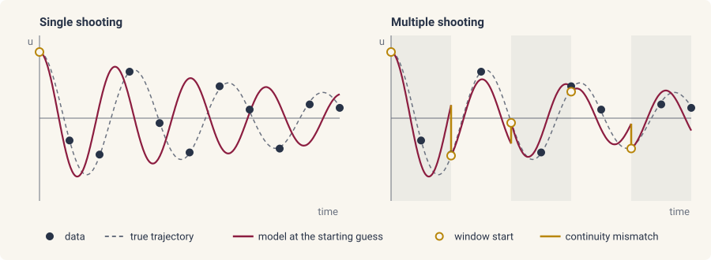
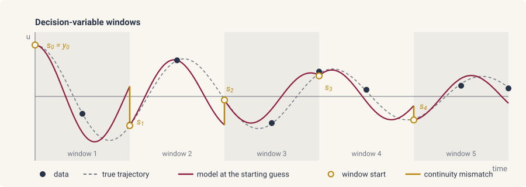

# Multiple shooting

This page provides an overview of multiple shooting in diff-soup. The
recipe, data, and inference problem are those of
[fitting parameters](fitting.md).

## An overview of multiple shooting

Suppose we have observations \(u_0, u_1, \dots, u_N\) of the state at
the times \(t_0 < t_1 < \dots < t_N\) and a model with parameters
\(\theta\). A single-shooting fit integrates the model from \(u_0\)
over the whole horizon \([t_0, t_N]\) and minimizes the misfit
\(\sum_n \|\hat u(t_n;\theta) - u_n\|^2\) over \(\theta\). Every
observation is then predicted through one long solve, so a poor
starting guess drifts away from the data along the horizon, as in the
left panel below.



Multiple shooting partitions the horizon into windows
\([\tau_{w-1}, \tau_w]\), \(w = 1, \dots, W\), and integrates each
window from its own start state \(s_{w-1}\), with \(s_0 = u_0\). The
window starts join \(\theta\) as decision variables, and the loss adds
a continuity term that pulls the end of each window to the start of the
next. Writing \(\Phi(s;\theta)\) for the state a window reaches when it
starts from \(s\),

$$
\min_{\theta,\, s_1, \dots, s_{W-1}}\;
\sum_n \|\hat u_w(t_n;\theta, s_{w-1}) - u_n\|^2
\;+\; \sum_{w=1}^{W-1} \big\|s_w - \Phi(s_{w-1};\theta)\big\|^2_{W_c},
$$

where each observation is predicted on the window \(w\) that contains
\(t_n\) and \(W_c\) weights the continuity term. At the solution the
mismatches vanish and the windows join into one trajectory.



## Two window modes

`ds.inference.Multishoot(windows, continuity=None, states=None)` is passed
as `ds.inference.Experiment(trajectory=)`, or as
`ds.inference.InferenceProblem(trajectory=)` to apply it to every
experiment, and the `windows` constructor selects the mode.

- `ds.inference.Windows.from_data(source=None)` starts every window from
  a measured state, one window per consecutive pair of frames. Only the
  parameters are fitted, and there is no continuity term. This needs a
  data stream that observes the full state, named by `source=` when
  there are several.

```python
experiment = ds.inference.Experiment(problem, solver, (0.0, 0.1), y0, (measurement,),
                                     trajectory=ds.inference.Multishoot(ds.inference.Windows.from_data(source="u")))
infproblem = ds.inference.InferenceProblem(experiment, parameters=D)
infproblem.n_segments      # 4, one window per consecutive pair of frames
result = ds.inference.optsolve(infproblem)
result[D]            # 0.298
result.diagnostics.per_series_cost   # one cost per window
```

`infproblem.n_segments` is the window count, and
`result.diagnostics.per_series_cost` holds one cost per window. A
measurement with the default readout (no `observe=`) seeds the windows,
and a partial readout is refused.

- `ds.inference.Windows.at(ts)` places window boundaries at the times
  `ts`, from the initial time to the last frame, and fits the window
  starts beside the parameters. `ds.inference.Windows.uniform(n)` places
  `n` equal windows over the same horizon.

```python
windows = ds.inference.Windows.at(jnp.concatenate([jnp.array([0.0]), ts]))
experiment = ds.inference.Experiment(problem, solver, (0.0, 0.1), y0, (measurement,),
                                     trajectory=ds.inference.Multishoot(windows, ds.inference.Continuity(weight="auto")))
infproblem = ds.inference.InferenceProblem(experiment, parameters=D)
infproblem.n_params        # 121, one diffusivity and four window starts of 30 differential values
result = ds.inference.optsolve(infproblem)
result[D]            # 0.2993
result.window_states.shape               # (4, 30)
result.diagnostics.window_obs_rank       # (30, 30, 30, 30)
result.diagnostics.continuity_defect_wrms   # one defect per window, in state units
```

The window starts are initialized from one solve at the starting
parameters. `result.window_states` holds their fitted values, and
`result.params` leads with the parameters. For a DAE, only the
differential part of the state is fitted per window and the algebraic
part is recovered from it
([consistent initialization](../simulation/consistent-init.md)).

With the window starts fitted, `ds.inference.optsolve` defaults to
`ds.inference.NewtonTrustRegion(hessian="gauss-newton")`. The memory of the
exact Hessian grows with the square of the decision vector, and a few
hundred entries can already exceed the device.

## Options

The options, with their defaults:

- `continuity=ds.inference.Continuity(weight="auto")` weights the
  continuity term at the scale of the data misfit, from the solver's
  tolerances and the observation weights. A positive float `weight=W`
  weights every continuity row by \(\sqrt{W}\) instead.
- `states=ds.inference.StateBasis.full()` fits every differential entry
  of a window start. `ds.inference.StateBasis.from_modes(B)` fits only a
  coefficient vector in the column-orthonormal basis `B`, which shrinks
  the decision vector when the state is large.

## Batching and derivatives

- Each window is solved once per evaluation, saving its frames on the
  way, so a fit integrates the horizon once however many frames a window
  holds.
- The windows solve as one batch. A `jax.vmap` over parameter values
  of the likelihood joins that batch, and so do the chains of
  [`ds.inference.sample`](mcmc.md#run-the-sampler).
- `jax.grad` of the likelihood runs with the solver's reverse adjoint,
  `ds.CheckpointAdjoint()` by default. Take the gradient of a function
  that calls the likelihood, not of a `jax.jit` around it.

## Reading the result

- `result.diagnostics.continuity_defect_wrms` gives, per window, the
  root mean square of the continuity mismatch in state units. At a good
  solution every entry is small.
- `result.diagnostics.window_obs_rank` gives, per window, how many
  directions of the window start the data inside that window determine,
  and an under-determined window is noted in `warnings`.
- `result.diagnostics.continuity_unrepresented` gives, per window, the
  mismatch a reduced `StateBasis` cannot represent, and the diagnostics
  carry a note to widen the basis when it is large.
- A decision vector beyond 2000 entries warns that the dense
  Gauss-Newton solve is the cost wall. The exact Hessian reaches its
  wall far earlier, and a fit that would exceed the device memory
  stops before it starts with an error naming `hessian_tile=`.
- Windows with fitted starts take exactly one measurement. A second
  measurement is refused.
- `ds.inference.Experiment(..., initial_state=ds.inference.LearnedInitialState(guess))`
  adds the start of the first window to the decision vector
  ([data assimilation](data-assimilation.md#estimating-the-initial-condition)).
